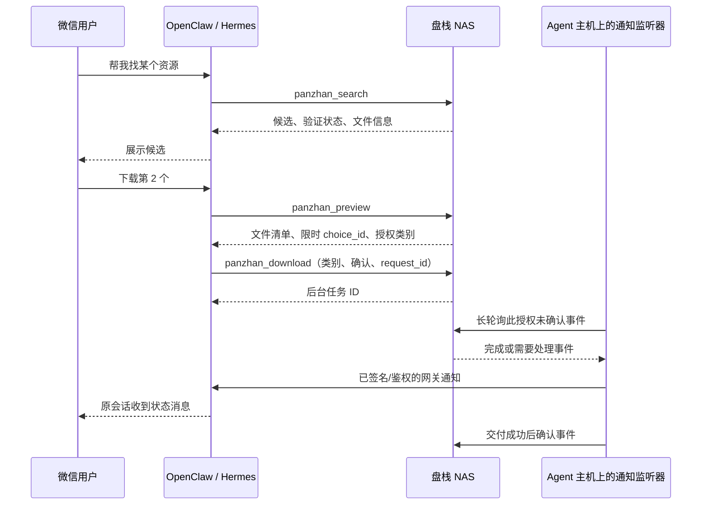

# OpenClaw / Hermes 接入盘栈

盘栈 0.2.2 提供内置 MCP Streamable HTTP（JSON 响应、无服务器主动 SSE 流）和等价的授权 HTTP API。接入包包含 [Hermes 盘栈 Skill](../integrations/agents/panzhan/README.md)，同一个 Skill 支持首次配置和日常使用；通用 [Agent 操作说明](../integrations/agents/AGENT-INSTRUCTIONS.md) 也可放入其他 Agent 工作区，实际工具与授权均由盘栈执行。后台任务会自动恢复临时网络故障，状态为 `retrying` 时返回 `next_retry_at`，Agent 无需重复创建任务。

## 交互流程



目前支持夸克分享。微信登录、用户白名单和消息收发在 Agent 网关配置，不在盘栈内实现微信协议。

## 授权与地址

先在「设置 → 下载位置」保存 NAS 共享根目录和默认目录，再在同页「Agent 授权」为电影、电视剧、动漫、音乐、学习资料或软件选择已存在的分类子目录。分类目录必须位于默认目录下；盘栈不会自动创建目录。创建授权只需设置名称、有效期和下载权限，下载授权自动继承当时的默认目录及分类映射。未配置的类别不会提供给 Agent，`other` 始终保存到授权默认目录。完整令牌只返回一次；盘栈存储其 SHA-256 摘要。每个 Agent 单独创建令牌，可随时撤销；令牌只允许列出的工具，不能访问管理设置或夸克账号接口。

| 部署方式 | MCP 地址 |
| --- | --- |
| Agent 与盘栈同机、原生进程 | `http://127.0.0.1:9867/mcp` |
| Agent 在 NAS 的容器中 | 使用容器可达的 NAS 宿主机地址；容器自己的 `127.0.0.1` 不是 NAS |
| Agent 在其他局域网机器 | `http://NAS局域网IP:9867/mcp` |
| Agent 跨网络部署 | 使用已配置且 Agent 可达的 VPN 地址或 HTTPS 反向代理地址 |

此功能不会自动开放路由器端口或建立公网隧道。MCP 客户端与通知监听器均主动连接盘栈；监听器运行在 Agent 主机上，再连接本机的 Agent Webhook，因此盘栈不需要反向访问远程 Agent 的私有地址。

授权包含 `resources:read`（搜索/预览）、`downloads:create`（后台下载）、`tasks:read`（本授权任务）、`events:read`（本授权事件与确认）。授权创建时固定下载根、默认目录和分类映射快照；之后修改盘栈设置不会改写既有授权，需撤销并重新创建以应用新配置。Agent 先预览，再从本次预览返回的分类 ID 中选择；下载接口不接受 Agent 提交的路径。类别目录被删除或失去权限时，任务会返回错误，不会静默改存其他位置。没有分类快照的旧授权继续使用创建时固定目录和旧请求格式。事件和任务按授权隔离，同一授权可以通过 `context` 路由别名区分会话；别名不是微信身份验证，网关必须限制谁能使用该 Agent。

## MCP 配置

在 Agent 进程环境中设置 `PANZHAN_AGENT_TOKEN` 为刚创建的令牌。合并配置而不是覆盖现有配置：

- OpenClaw：[openclaw-mcp.example.json](../integrations/agents/openclaw-mcp.example.json)，键为 `mcp.servers.panzhan`，transport 为 `streamable-http`。
- Hermes：[hermes-mcp.example.yaml](../integrations/agents/hermes-mcp.example.yaml)，键为 `mcp_servers.panzhan`。

地址按上表替换，Authorization 使用 `Bearer ${PANZHAN_AGENT_TOKEN}`。这是静态访问令牌接入，不是 OAuth 登录。客户端重载 MCP 后执行工具发现，下载权限未开启的授权不会看到下载工具。

工具：`panzhan_sources`、`panzhan_search`、`panzhan_preview`、`panzhan_download`、`panzhan_tasks`、`panzhan_events`、`panzhan_ack_event`。预览选择有效 15 分钟；搜索最多返回 20 项，默认 5 项。目录大小只有已知时才返回，当前目录含文件夹时不冒充递归总大小。

确认下载需要 `choice_id`、`request_id`、`user_confirmed: true`。同一 `request_id` 重试不会重复创建任务；同一选择即使用不同请求 ID 再次确认，也会返回已有任务。此处不独立验证微信对话中的确认，Agent 必须遵守操作说明和自己的审批/用户权限设置。

## 完成通知

需要 Python 3.10+，监听器只依赖标准库。在 Agent 主机运行 [scripts/agent_event_relay.py](../scripts/agent_event_relay.py)。设置两个环境变量：

每个授权运行一个监听器；多个 Agent 应使用各自令牌、路由表和独立的 `--state-file`，避免多个进程同时处理同一授权。Agent 与盘栈同机时，Python 运行在同一设备或其 Agent 容器内；盘栈 Go 服务不依赖 Python。

- `PANZHAN_AGENT_TOKEN`：盘栈 Agent 访问令牌。
- `PANZHAN_DELIVERY_SECRET`：Agent 网关的 Hook Bearer token（OpenClaw）或 HMAC secret（Hermes），与盘栈令牌分开。

复制 [routes.example.json](../integrations/agents/routes.example.json)，将 `wechat:owner` 对应的 `channel`、`to` 配置为实际微信网关频道与收件会话。`context` 是这个路由表的键；资源和事件数据不能更改路由。多会话需逐项配置，可为条目配置 `delivery_url` 指向操作者选定的其他网关；不要把真实路由表或环境文件提交到公共仓库。

### OpenClaw

先在 OpenClaw 启用并保护 `/hooks/agent`，其 Hook token 与 `PANZHAN_DELIVERY_SECRET` 一致。按官方文档限制允许的 Agent；示例路由使用 `main`。示例微信插件频道 ID 为 `weixin`，以实际安装的网关插件标识为准。

```sh
python3 scripts/agent_event_relay.py \
  --base-url http://NAS地址:9867 \
  --mode openclaw \
  --delivery-url http://127.0.0.1:18789/hooks/agent \
  --routes /path/to/private-routes.json \
  --state-file /path/to/private-relay-state.json
```

监听器把状态转为 Hook 消息，收件人来自本地路由表。OpenClaw 返回任务接受结果后确认盘栈事件；后续微信交付由 OpenClaw 网关负责。网关接受不等同于微信最终送达，消息失败应在 OpenClaw 中排查。

### Hermes

在 Hermes 环境设置 `WEBHOOK_SECRET`，与监听器的 `PANZHAN_DELIVERY_SECRET` 相同，合并 [hermes-webhook.example.yaml](../integrations/agents/hermes-webhook.example.yaml)。确认微信网关已登录并限制允许用户。示例使用 `deliver_only: true`，直接发送状态文本，无需为完成通知运行模型。

```sh
python3 scripts/agent_event_relay.py \
  --base-url http://NAS地址:9867 \
  --mode hermes \
  --delivery-url http://127.0.0.1:8644/webhooks/panzhan \
  --routes /path/to/private-routes.json \
  --state-file /path/to/private-relay-state.json
```

监听器为同一 JSON body 计算 `X-Hub-Signature-256`，并发送稳定交付 ID；只在 Hermes 报告 `delivered` 或 `duplicate` 后确认。错误、ignored、未知路由或交付失败都保留事件重试。可通过系统服务或容器重启策略常驻监听器；它不是在 NAS 内自动安装的 Agent 进程。

通知是可重试、至少一次交付语义。监听器用本地原子保存的事件 ID 避免接受成功后 ACK 丢失时再次发送；POST 结果不明时仍可能重发，需要网关的幂等 ID 去重。不要承诺任何异常情况下消息绝不重复。已确认事件保留 24 小时，未确认事件跨盘栈重启保留；撤销授权停止该授权的后续交付。

## HTTP API

所有请求使用 `Authorization: Bearer <Agent令牌>`；写请求为 `application/json`。Agent 令牌不能作为管理 Cookie 使用，也不能调用诊断或账号设置。

| 请求 | 功能 |
| --- | --- |
| `GET /api/agent/v1/status` | 此授权的能力与目录 |
| `GET /api/agent/v1/sources` | 已启用来源 |
| `POST /api/agent/v1/search` | `query`、可选 `limit`/`source_id`/`local_only` |
| `POST /api/agent/v1/preview` | `url`、`context`、可选 `code`/`title` |
| `POST /api/agent/v1/downloads` | `choice_id`、`request_id`、`user_confirmed` |
| `GET /api/agent/v1/tasks` | 可选 `task_id` / `context` |
| `GET /api/agent/v1/events?wait_seconds=20` | 最多等 20 秒，最多取 50 条未确认事件 |
| `POST /api/agent/v1/events/ack` | `event_id`，幂等确认 |

## 验证范围与官方资料

离线 fixture 覆盖搜索到真实文件落盘、确认与任务幂等、跨授权隔离、到期/撤销、事件重启补取与 ACK、通知 HMAC 和崩溃恢复。浏览器测试覆盖设置页创建/隐藏/撤销授权。没有使用真实微信账号发送测试消息；实际 Agent 版本、微信网关登录和目标会话仍需部署端验证。

- [OpenClaw MCP](https://docs.openclaw.ai/tools/mcp)
- [OpenClaw inbound webhooks](https://docs.openclaw.ai/automation/cron-jobs/webhooks)
- [Hermes MCP](https://hermes-agent.nousresearch.com/docs/user-guide/features/mcp/)
- [Hermes webhooks](https://hermes-agent.nousresearch.com/docs/user-guide/messaging/webhooks/)
- [MCP Streamable HTTP](https://modelcontextprotocol.io/specification/2025-06-18/basic/transports)
